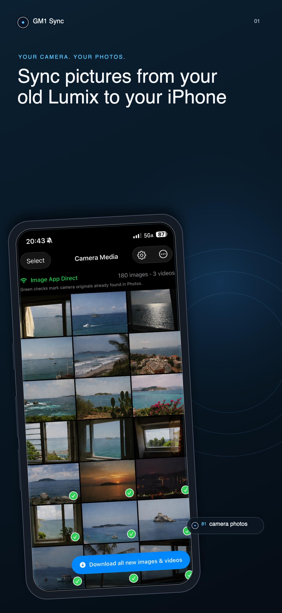
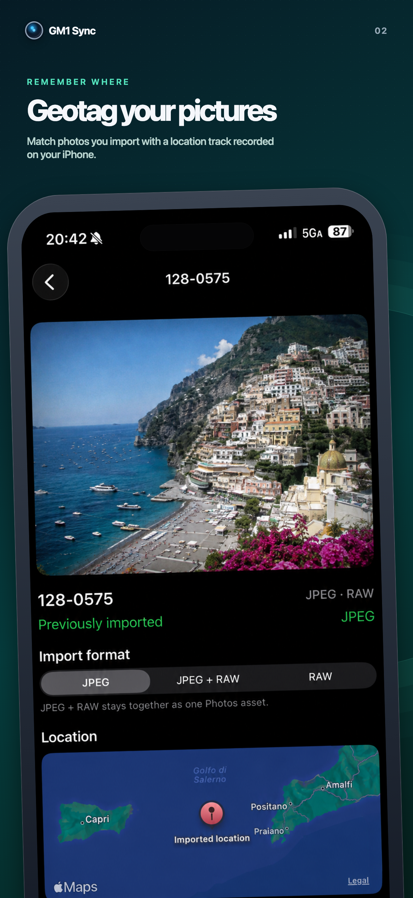
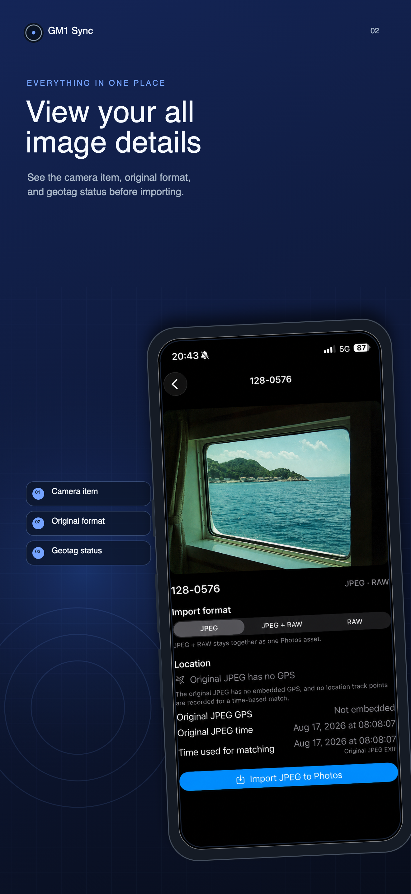

# Retro LUMIX Sync

<p align="center">
  
  
  
</p>

[](https://apps.apple.com/us/app/gm1-sync/id6801485290)

Retro LUMIX Sync is an independent iPhone and Mac app for browsing, importing, and geotagging media from compatible Panasonic Wi-Fi cameras. It is an alternative to Panasonic's **Image App** for people who still use these cameras.

The Panasonic Lumix DMC-GM1S is the primary camera validated on real hardware. The GM1, GM5, and other Image App-era Panasonic Lumix cameras from roughly the 2010s may use a compatible protocol, but model and firmware support must be verified individually. See [COMPATIBILITY.md](COMPATIBILITY.md).

Retro LUMIX Sync is not affiliated with or endorsed by Panasonic. Panasonic, LUMIX, Image App, and the camera model names belong to their respective owners.

## Features

- Connect by scanning the camera's Wi-Fi QR code or entering its Wi-Fi name and password.
- Browse photos and videos stored on the camera.
- Preview photos and play camera-provided MP4 videos.
- Import JPEG, JPEG + RAW, RAW-only, and supported MP4 originals into Apple Photos on iPhone.
- Mark previously imported items by reconciling camera filenames with the Photos library.
- Download all new photos and videos in one action.
- Select images and assign a searched Apple Maps location before importing them.
- Record an optional on-device location track and add a matched location during photo import.
- Write a recorded location track into the photos on the camera's SD card (cameras that support it), and set the camera clock from the iPhone.
- Receive each JPEG as it is taken with the camera's **Send Images While Recording → Smartphone** mode, in a foreground receiving session that saves every photo to Apple Photos.
- Shoot remotely from iPhone with a live viewfinder: still photos, video, touch AF and touch shutter, power zoom where the lens allows it, manual focus, and the exposure, ISO, white-balance, drive-mode, and focus settings the camera reports.
- On Mac, join the camera Wi-Fi from the macOS menu bar, run the protocol probes, and copy downloaded originals to Downloads.
- Keep camera traffic local between the iPhone and the camera, without accounts, analytics, ads, or cloud uploads.

AVCHD items can appear in the gallery when advertised by the camera. The tested GM1S advertises an AVCHD `.TS` URL that its media server does not serve, so AVCHD playback and import are shown as unavailable rather than promised as supported.

## The home screen

The iPhone app opens on a home screen organized by what you want to do. The app icon you chose sits in front of the title; tap it to choose another. The camera names in the description ("GM1, GX7, and LX100 and more") open **Cameras that work with this app**, the camera list by era. A camera with a matching custom app icon shows it in its row (the GM1 shows both of its icons); tapping an icon offers it as the app icon, with the custom icons purchase if they're still locked.

- **Geotagging:** a short explanation and the location log's status with **Start** and **Stop**. **Geotagging settings** holds the widget setup, automatic start, Google Timeline import, clearing the track, and the camera clock adjustment.
- **With your camera:**
  - **Get photos from the card**, **Shoot from your iPhone**, **Write locations to camera photos**, and **Set the camera clock** use the camera's **Remote Shooting & View** connection.
  - **Receive photos as you shoot** uses **Send Images While Recording**.

  Each job shows the camera steps for its connection and joins the camera's network: the remembered network, its QR code, or a name and password.
- **About:** a note from the developer (including the price of the custom app icons), the app icon, the source code on GitHub, **Feature requests welcome** (opens a new GitHub issue), **Developer settings** (connection, remembered camera, camera address, and protocol tests), and the app version.

Once connected, the camera screen switches between **Photos** and **Live view** at the top; going back to the home screen keeps the connection.

## Custom app icons

Blue Camera is the free app icon. **Lens**, **Black Camera**, and nine camera model icons (GM1S, GM1, GX85, GX9, G85, FZ80, FZ300, FZ1000) are an optional one-time In-App Purchase that supports development. Someone already using Lens or Black Camera when this version first runs keeps those two free. **App Icon** offers **Restore purchase**, and the camera list offers each camera's icon. See [docs/custom-app-icons.md](docs/custom-app-icons.md) for the App Store Connect setup and testing.

## Connect a GM1S

On the camera choose:

```text
Wi-Fi → New Connection → Remote Shooting & View → Direct → Image App
```

On the home screen pick **Get photos from the card**, then join the network the camera shows: with **Join** for a camera the app remembers, its QR code, or its name and password. This one **Image App Direct** connection is sufficient for browsing previews and importing supported originals; do not switch to **Send Images Stored in the Camera**.

## Confirmed GM1S protocol

Real-device testing confirms that Retro LUMIX Sync can:

- reach the camera's local `cam.cgi` control endpoint;
- switch the camera into playback mode;
- enumerate SD-card items through UPnP `ContentDirectory:1`;
- load `CAM_TN` and `CAM_LRGTN` previews;
- download original JPEG and RAW resources advertised by the camera;
- import supported MP4 resources; and
- save supported originals to Apple Photos.

The protocol is unofficial and can vary by camera model and firmware.

## Remote shooting

On the home screen tap **Shoot from your iPhone**, or switch the connected camera screen to **Live view**. Retro LUMIX Sync asks the camera for remote control (accept the request on the camera if it asks), switches it to recording mode, and shows the camera's UDP live view.

- **Shutter:** tap to take one photo, or touch and hold for burst shooting when the camera's drive mode is set to burst. A photo is reported as saved only after the camera shows card activity or a lower remaining-shot count; an accepted shutter command alone is not treated as proof.
- **Video:** start and stop recording on the camera's card.
- **Touch:** in **AF** mode a tap moves the camera's AF area; in **Shutter** mode a tap focuses at that point and takes a photo.
- **Zoom:** shown only when the camera lists its power-zoom commands and the lens reports a focal-length range.
- **Manual focus:** near/far buttons appear in MF focus mode and show the position the camera reports.
- **Settings:** shutter speed and aperture follow the mode dial (A, S, or M). ISO, exposure compensation, white balance, drive mode, focus mode, AF area, and focus peaking list only the values the camera's own menu offers, with values the current mode disables shown as unavailable. If a camera does not provide its menu, current values are shown read-only.

Only one part of the app controls the camera's mode at a time. Opening or refreshing the gallery waits while remote shooting holds the camera in recording mode, and when you return to the gallery it switches the camera back to playback and reloads so new photos appear. Requests that belong to an earlier connection are refused, so a slow command cannot reach a camera that joined afterwards at the same address.

Live view pauses while the app is in the background and resumes when you return. If the camera is switched to playback or operated directly, remote control pauses and resumes when the camera returns to recording mode. Leaving the screen stops a video recording started from it.

## Send Images While Recording

On the camera choose **Wi‑Fi → Wi‑Fi Function → New Connection → Send Images While Recording → Smartphone → Direct → Manual Connection**. In Retro LUMIX Sync tap **Receive photos as you shoot → Start receiving**, then **Join** the camera's network on that screen (or join it in Settings and come straight back to the app). When the camera lists "Retro LUMIX Sync", select it, choose **Size → Original** for full-size JPEGs, and press **Set**.

- Each JPEG is reported as saved only after Photos has saved it.
- Incomplete uploads are discarded, and repeated deliveries of the same bytes are skipped.
- Files that cannot be saved yet, for example without Photos access, are kept on the iPhone until **Try saving again** succeeds.
- Receiving is a foreground session that keeps the screen on. It pauses when the iPhone locks or the app leaves the foreground, and resumes when you return. A photo taken while the app is away is not sent: a GM1S then shows **Connection error** and stops sending until you start its connection again. The photo stays on the card.
- A received JPEG counts as the card original only after the gallery compares it with the file on the card. A byte-identical original is then recorded as imported without saving a duplicate.

Verified on a DMC-GM1S: the camera's own search reaches the app, which answers it directly, so the camera finds Retro LUMIX Sync without Apple's multicast networking entitlement (iOS 27.2, development build). See [docs/send-images-while-recording.md](docs/send-images-while-recording.md) for the exchange the camera uses, the entitlement request, and the checks still to run.

## Geotagging

On iPhone, tap **Add geotagging widget to home screen** in **Geotagging settings** on the home screen for a widget preview and setup guide. On iOS 18 or later, touch and hold the Retro LUMIX Sync app icon on the Home Screen, then choose the small widget. The guide also includes the widget-gallery route for other versions or layouts. iOS requires adding the widget from the Home Screen; the app cannot place it automatically.

Tap the **Geotagging** widget to turn location tracking on, then tap it again to turn tracking off. Each tap opens the app and applies the action automatically; the first start asks for location permission if needed. Stopping keeps your saved track for later photo imports. A manual stop stays off when returning to the app, even with automatic start enabled, until you start tracking again or relaunch the app.

The widget shares only the logging status with the app, never coordinates or location samples. Its display refreshes after changes made in the app. iOS controls when widget refreshes appear, so the displayed status can lag behind the app, including after force-quitting it.

Location logging is optional and visible while active. During import, Retro LUMIX Sync reads the original JPEG's EXIF capture time and matches it to a nearby or interpolated point in the locally stored location track. A camera-clock adjustment can compensate when the camera clock differs from the iPhone clock.

If logging was not enabled when the photos were taken, iPhone users can export `location-history.json` from Google Maps (Settings → Personal content → Export Timeline data) and choose **Import Google Timeline JSON** in **Geotagging settings**. If the JSON text is already copied, **Paste Google Timeline JSON** accepts it directly from the clipboard. The imported points are merged into the local track; the app does not sign in to Google or upload the file.

For a direct override, select one or more images in the camera gallery and choose **Set location**. Search Apple Maps, confirm a result, and Retro LUMIX Sync stores that location locally for each selected camera item. The override is reused after reconnecting to the same camera and is applied when the image is imported to Apple Photos; selected videos are not affected.

Matches more than 15 minutes from a usable track point are rejected. The original camera file remains unchanged; on iPhone the matched `CLLocation` is supplied separately when the asset is created in Apple Photos. On Mac the match is shown for review while the original is copied unchanged to Downloads.

### Write the track to photos on the camera

Cameras that support it can write the recorded track into the photos on their own SD card, as Panasonic's Image App does. On the home screen choose **Write locations to camera photos**, or open **Gallery actions → Write locations to camera photos…** on the connected camera screen. Choose the track period (the latest continuous recording by default), and confirm.

Retro LUMIX Sync uploads the track and asks the camera to write. The camera chooses the photos by comparing each photo's capture time on its own clock with the track. Panasonic excludes photos that already contain location information, AVCHD videos, photos taken after the upload, and photos taken while the clock was not set. The app cannot choose individual photos, and RAW and RAW+JPEG behavior has not been verified.

Writing changes the original files on the card and cannot be undone from the app; use a backed-up or disposable card the first time. A "finished" report comes from the camera itself and is not treated as proof: **Check photos in this period** reads the original JPEGs back from the card and compares their GPS data with the track.

### Set the camera clock

**Set the camera clock** on the home screen, or **Gallery actions → Set camera clock…** on the camera screen, sets the camera's date and time from the iPhone on the next whole minute and reads the clock back where the camera allows it. Do this before shooting. It is separate from location writing, which only tells the camera the iPhone's current time before the upload and does not change the camera's clock. Like Image App, the app sends UTC time with the standard (non-daylight-saving) offset, so the camera's own Daylight Saving setting must match.

## Privacy

Retro LUMIX Sync has no accounts, advertising, analytics, tracking, or cloud service. Camera credentials are stored in the platform Keychain and are not written to diagnostics. Location tracks and camera diagnostics remain on the device or Mac. See [PRIVACY.md](PRIVACY.md) for details.

## Build and test

The project uses [XcodeGen](https://github.com/yonaskolb/XcodeGen):

```bash
brew install xcodegen
xcodegen generate
open LumixProbe.xcodeproj
```

Select your own Apple development team in Xcode before installing on a physical iPhone. If you are not signing for the published app, also replace the bundle identifiers with identifiers owned by your team. A physical device is required to validate Hotspot Configuration, camera networking, Photos import, and real-camera protocol behavior. Unit and simulator UI tests can run without a camera.

The iPhone app embeds a `LocationTrackingWidget` extension. For device signing, provision the extension bundle ID and enable the same App Group (`group.com.web3.gm1sync`) for both the app and extension. When using your own bundle identifiers, update the group identifier in `project.yml` and `Shared/LocationTrackingWidgetState.swift` as well.

Keep ad hoc code signing enabled when testing the widget in Simulator. A build with `CODE_SIGNING_ALLOWED=NO` can compile successfully while omitting the App Group entitlement, preventing the app and widget from sharing tracking status.

The generated project also contains a native `GM1SyncMac` target. Build it with:

```bash
xcodebuild -project LumixProbe.xcodeproj -scheme GM1SyncMac -sdk macosx build
```

On Mac, join the camera Wi-Fi from the macOS menu bar before launching Retro LUMIX Sync. The Mac app uses the same camera address and protocol probe as iPhone, but does not use iPhone-only QR scanning or hotspot configuration. The **Download first original JPEG** action copies the camera bytes to the Mac user's Downloads folder instead of importing them into Apple Photos. Location logging works while the Mac app is open; iPhone continues to support visible background location logging and direct Photos import.

## Protocol notes

Camera control uses local HTTP endpoints such as:

```text
GET http://192.168.54.1/cam.cgi?mode=getstate
GET http://192.168.54.1/cam.cgi?mode=camcmd&value=playmode
GET http://192.168.54.1/cam.cgi?mode=get_content_info
```

Remote shooting adds:

```text
GET /cam.cgi?mode=accctrl&type=req_acc&value=0&value2=GM1Sync
GET /cam.cgi?mode=camcmd&value=recmode
GET /cam.cgi?mode=startstream&value=<phone UDP port>      (keep-alive: getstate about once a second)
GET /cam.cgi?mode=camcmd&value=capture | capture_cancel | video_recstart | video_recstop
GET /cam.cgi?mode=camctrl&type=touch&value=<x>/<y>&value2=on      (0–1000 grid)
GET /cam.cgi?mode=camcmd&value=tele-normal | wide-normal | zoomstop
GET /cam.cgi?mode=camctrl&type=focus&value=tele-normal | wide-normal   (far | near)
GET /cam.cgi?mode=getinfo&type=allmenu | curmenu | lens
GET /cam.cgi?mode=getsetting&type=iso   /   setsetting&type=iso&value=800
```

Each live-view datagram carries a 32-byte header, an optional extension with AF frames and the live exposure, and one JPEG. Malformed or incomplete frames are dropped, and only datagrams from the camera's address are accepted.

Location writing and the clock use (from Panasonic Image App analysis; not yet confirmed on a GM1S):

```text
GET  /cam.cgi?mode=setsetting&type=clock&value=YYYYMMDDhhmmss%2BHHMM   (set the clock; UTC fields + standard offset)
GET  /cam.cgi?mode=camcmd&value=playmode
GET  /cam.cgi?mode=notify&type=clock&value=YYYYMMDDhhmmss%2BHHMM       (tell the camera the phone's time)
GET  /cam.cgi?mode=startsenddata&type=geodata&value=<bytes>&value2=1   (expects <method>once</method>)
POST /cam.cgi?mode=senddata&value2=1                                   (multipart, boundary xyzxyz, bindata.bin)
GET  /cam.cgi?mode=camctrl&type=add_location_data&value=start | abort
GET  /cam.cgi?mode=getprogress&type=add_location_data                  (prepare, exec, finish, or error)
```

The track is an 8-byte header followed by 16-byte little-endian records: GPS-epoch seconds, latitude and longitude × 10⁷, altitude in metres, and `A` for samples or `V` for the end of each continuous segment.

Media enumeration uses a UPnP `ContentDirectory:1` SOAP request. Returned DIDL-Lite items may expose multiple resources for one camera item. Retro LUMIX Sync groups them by item ID and resolves profiles according to their purpose:

| Purpose | Preferred profiles |
|---|---|
| Grid thumbnail | `CAM_TN`, then `CAM_LRGTN` |
| Detail preview | `CAM_LRGTN`, then `CAM_TN` |
| Original JPEG | `CAM_ORG`, then `CAM_RAW_JPG` |
| RAW companion | `CAM_RAW` |
| MP4 video | `CAM_MP4` and compatible MP4 resources |

Previews are cached in memory. Originals are downloaded on demand, handed to Photos unchanged, and removed from temporary app storage after the import attempt.

## Help and compatibility reports

- [Support and troubleshooting](SUPPORT.md)
- [Camera compatibility candidates](COMPATIBILITY.md)
- [Open a GitHub issue](https://github.com/seichris/lumix-panasonic-2010-era-image-sync-iphone-app/issues/new)

## Protocol references

The implementation draws on behavior independently implemented or reverse-engineered in:

- `gphoto/libgphoto2`, `camlibs/lumix/lumix.c`
- `peci1/lumix-link-desktop`
- `SahajJain01/lumix-local` (GX80 live-view packet layout, menu schema, and Image App command analysis)
- `KerbalNo15/Shutterlink` (Send Images While Recording receiver, tested by its author on a GM1 and a G85)
- Panasonic Image App documentation and support history
- Panasonic/Lumix UPnP device descriptions exposing `ContentDirectory:1`
